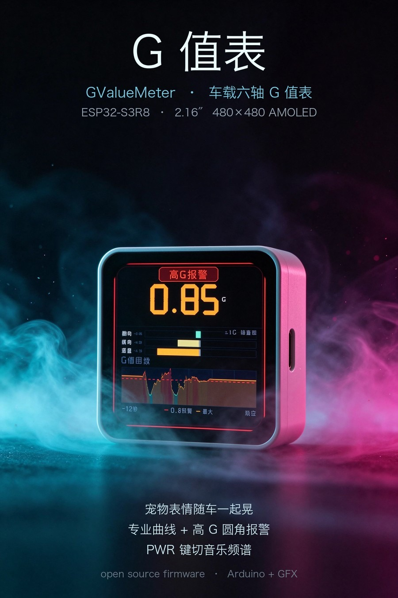
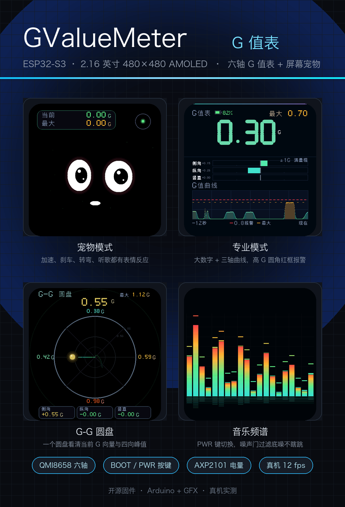
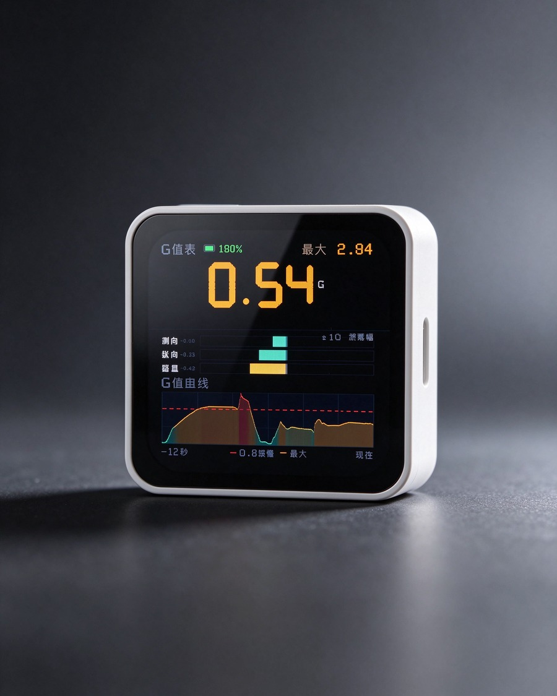
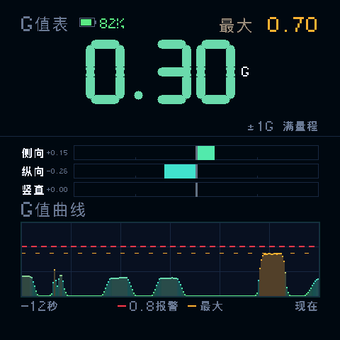
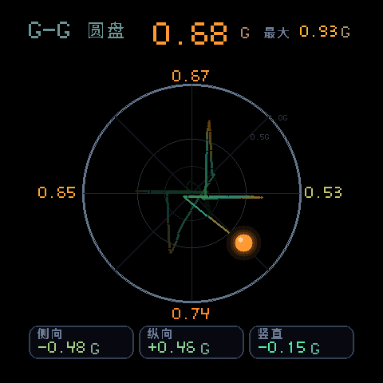
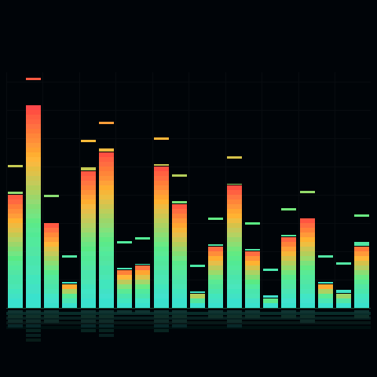

# GValueMeter · 车载 G 值表 + 屏幕宠物


-f59e0b?style=flat-square)


**微雪 ESP32-S3-Touch-AMOLED-2.16 上的六轴 G 值表固件**：把一块 2.16 英寸方形 AMOLED 挂在车里，实时显示过弯 / 加减速的 G 值，还养了一只跟着车身一起晃的表情宠物，按 PWR 键还能变成一块音乐频谱灯。

灵感来自小红书 @飞翔的AMX 的 DIY 分享（领克 Z20 不给适配 EVA，只能自己做 🐶），界面走了 EVA / NERV 那一套深色 + 荧光绿的仪表盘风格。



---

## 目录

- [它能干什么](#它能干什么)
- [功能一览](#功能一览)
- [按键操作](#按键操作)
- [硬件](#硬件)
- [技术架构](#技术架构)
- [编译与烧录](#编译与烧录)
- [串口命令](#串口命令)
- [模拟器](#模拟器)
- [目录结构](#目录结构)
- [已知限制](#已知限制)
- [致谢](#致谢)

---

## 它能干什么

一句话：**开车时它告诉你「刚刚那一下有多狠」，不开车时它是一只会晕车的小宠物。**



### 三种界面

| 界面 | 内容 |
|------|------|
| 🐾 宠物模式 | 一张圆脸 + 顶部实时 / 最大 G 值；表情跟着车身动 |
| 📊 专业模式 | 七段数码大数字当前 G、三轴分量条、最近 12 秒 G 曲线、0.8G 高 G 报警 |
| 🎯 G-G 圆盘 | 一个圆盘看清当前 G 向量方向与四向峰值 |
| 🎵 音乐频谱 | 20 柱音频频谱，跟着车里放的音乐跳 |

### 样机



---

## ✨ 亮点

- **真车载场景打磨过**，不是桌面粉丝带。四角 56px 圆角屏的安全区、报警框与文字互不遮挡、按键全盲操，都是上车实测后一轮轮改出来的。
- **零触摸交互**：CST9220 触摸彻底弃用，只用 BOOT / KEY3 / PWR 三个实体键完成模式切换、开测、标定、重置。
- **三种界面一套画布**：宠物脸、七段数码专业页、G-G 圆盘共用同一块 480×480 画布与同一套基元，切页不掉帧。
- **性能靠架构抠出来**：全屏 `draw16bitRGBBitmap` 73ms 是硬天花板，于是做 20 条带差分推屏 + 专业页局部清屏（44ms → 29ms），把帧率从 6fps 拉到 9~17fps。
- **报警视觉不靠叠框**：单层辉光圆角框（同路径向内 3 圈递减），既贴合屏幕圆角，又不会压到任何数字；判定加 0.45s 迟滞，阈值附近不再逐帧闪。
- **音频按车内噪音标定**：噪声门与「听歌」判定都放到 dB 域，用实测车内噪音（怠速 35~45dB、60km/h 55~61dB、80km/h 58~64dB、120km/h 63~71dB）做参考，胎噪风噪不会把柱子顶上去了。
- **有模拟器**：同一套 UI 代码在 PC 上编译运行，一条 `bash sim/build.sh` 出 16 张效果图，改布局不用反复烧板子。

---

## 功能一览

### 🐾 宠物模式

- **待机**：呼吸节奏的圆脸，只剩一张脸，屏上不显示任何字（长按 BOOT 才开始测量）
- **加速 / 刹车**：整张脸顺着惯性的反方向大幅甩动，眼睛跟着瞪大 / 眯起，配挤压拉伸
- **左右转弯**：脸侧倾 + 视线偏移，幅度随横向 G 增大
- **减速带 / 颠簸**：X 眼 + 旋转星星，触发用峰值差 + 冷却时间，不会过一个小坑就抽一下
- **听歌**：板载 ES7210 双麦检测到一定音量以上才判定「在唱歌」，嘴巴开合 + 音符飘出；安静时不乱动
- **闲置小动作**：随机打哈欠（闭眼 + 大张嘴 + 头顶 Zzz）、视线游移
- **高 G**：超过阈值额头掉汗滴
- 单击 **BOOT** 可以隐藏 / 显示页面上的 G 值（状态写进 NVS，断电还记得）

### 📊 专业模式

- 七段数码**当前合成 G 值**（字间距单独调校，数字不会粘在一起）
- 顶部：电量图标（AXP2101 读数，充电时显示闪电）、历史最大 G
- 三轴分量条：侧向 / 纵向 / 竖直，中心零位、±1g 满量程
- 实时曲线：最近 12 秒，含 0.8G 报警参考线，黄段标出超限区
- **高 G 报警**：整屏圆角红框呼吸闪烁 + HIGH G 横幅，边框圆角贴合屏幕四角的圆弧
- 底部图例：-12秒 / 0.8报警 / 最大 / 现在



### 🎯 G-G 圆盘

- 当前 G 向量在圆盘上的位置 + 拖尾，直观看出「现在是被横着推还是被竖着压」
- 四个方向的峰值分别标在盘四周，一屏看全
- 高 G 时同样走圆角红框报警



### 🎵 音乐频谱

- **任意页面按 PWR 键即可切换到频谱**，再按一次回到原界面
- 20 根柱子铺满整屏宽度（8 → 472），横向渐变 + 峰值帽 + 短倒影
- **带噪声门**：先跟踪房间底噪，只有超过门限的音量才画（安静时频谱不会自己抖）
- 麦克风增益可调（ES7210 PGA，当前 42dB），配合 dB 压缩 + 只升不降的轻度 AGC



### 麦克风只在需要时开着

宠物模式「测量中」和频谱模式才启用麦克风，专业页 / G-G 页一律关闭采集，省电也省心。

---

## 按键操作

| 按键 | 引脚 | 操作 | 功能 |
|------|------|------|------|
| BOOT | GPIO0 | 单击 | 宠物页隐藏 / 显示 G 值（存 NVS） |
| BOOT | GPIO0 | 长按 1.5s | 开始 / 停止测量（待机 ⇄ 测量） |
| KEY3 | GPIO18 | 单击 | 下一个界面（宠物 → 专业 → G-G） |
| KEY3 | GPIO18 | 长按 | 开始测量 |
| PWR | AXP2101 PWRON | 单击 | 切换音乐频谱（任意页面） |

> **不使用触摸**：这块屏的 CST9220 在真机上干扰大，全部交互改成按键，戴手套开车也能按。

---

## 硬件

| 项目 | 规格 |
|------|------|
| 主控 | ESP32-S3R8（8MB OPI PSRAM + 16MB Flash，240MHz） |
| 屏幕 | 2.16" AMOLED 480×480，CO5300 驱动，QSPI，四角为圆弧（等效吃掉约 30px） |
| IMU | QMI8658 六轴加速度计 + 陀螺仪（I2C 0x6B） |
| 麦克风 | ES7210 双麦 ADC（I2S，0x40） |
| 电源 | AXP2101 PMU：电量 / 充电状态 / PWR 按键中断 |
| 背光 / PA | AMOLED 亮度寄存器控背光，喇叭 PA 使能 GPIO46 |

安装建议：固定在中控台或前挡附近、屏幕朝向驾驶员，**上电校准时保持车身静止约 1 秒**。

坐标系（当前真机标定）：`lat = +X`（右转离心为正）、`lon = -Z`（加速为正）、`vert = +Y`。

---

## 技术架构

```
IMU 5ms 采样 ──► 低通 + 合成 G + 零偏校准 ──► 峰值 / 峰值差 / 冷却 ──► 表情事件
MIC 16kHz ────► 高通 ──► 频段 FFT ──► dB 压缩 + AGC ──► 噪声门 ──► 频谱 / 唱歌判定
                                                    │
画布 (PSRAM 480×480×2) ◄── hud 基元库（七段数字 / 圆角框 / 曲线 / 气泡…）
        │
        └─► 48 行分带差分推屏（FNV 哈希比对，只推脏条）──► draw16bitRGBBitmap ──► CO5300
```

踩过的坑，写下来省得后来人再踩：

1. **不要自己写异步 DMA 推屏给 CO5300**。自建 `panel_qspi` 异步 DMA 能把 CO5300 推成永久黑屏（此后任何推屏路径都黑，只能硬件 RESET 救回）。主流程改用 GFX 官方 `draw16bitRGBBitmap` + PSRAM 画布，稳定但只有 8~12fps；诊断命令 `lcd reinit` 可以救回黑屏。
2. **这条 QSPI 实际吞吐只有约 6MB/s**。整屏 fill 21ms、全屏哈希 14ms、`draw16bitRGBBitmap` 73ms、`writePixels` 批量反而更慢（87ms）。所以做了 48 行分带 + 哈希差分，只推变化的条带，待机 12fps / 测量 9~10fps。
3. **`ESP32QSPI_MAX_PIXELS_AT_ONCE` 最多 16384**，再大就报 `txdata transfer > hardware max supported len`。
4. **屏幕四角会吃掉约 30px**。贴边内容要落在 [30, 450] 安全区，报警框必须用圆角边框而不是直角矩形，否则会在屏角处"戳出去"。
5. **麦克风电平很低**。ES7210 PGA 从 24dB 提到 42dB，再用 dB 压缩（-90dB→0、-45dB→1）+ 只放大不衰减的 AGC，频谱才有动态。

---

## 编译与烧录

固件是 **Arduino 风格 sketch**（`GValueMeter/GValueMeter.ino` + 同目录多个 `.cpp/.h`）。

### Arduino CLI

```bash
arduino-cli compile \
  --fqbn "esp32:esp32:esp32s3:USBMode=hwcdc,CDCOnBoot=cdc,FlashSize=16M,PSRAM=opi,PartitionScheme=app3M_fat9M_16MB,FlashMode=qio,CPUFreq=240" \
  GValueMeter

arduino-cli upload -p /dev/cu.usbmodem2101 \
  --fqbn "esp32:esp32:esp32s3:USBMode=hwcdc,CDCOnBoot=cdc,FlashSize=16M,PSRAM=opi,PartitionScheme=app3M_fat9M_16MB,FlashMode=qio,CPUFreq=240" \
  GValueMeter
```

### Arduino IDE

开发板选 **ESP32S3 Dev Module**，打开 **OPI PSRAM**、**USB CDC On Boot**，Flash 16MB、分区 `app3M_fat9M_16MB`。

### 依赖

- [GFX Library for Arduino](https://github.com/moononournation/Arduino_GFX)（CO5300 显示 + Canvas）
- QMI8658 / ES7210 / AXP2101 驱动已在工程内自带，不依赖 SensorLib

参考体积：Sketch ≈ 504KB（16%），全局变量 ≈ 29KB，余下给了 PSRAM 画布和字库。

---

## 串口命令

串口 115200：

| 命令 | 作用 |
|------|------|
| `help` | 列出全部命令 |
| `start` / `stop` | 开始 / 停止测量 |
| `mode` / `mode pet\|pro\|gg` | 切换界面 |
| `info` | 打印状态、轴向、峰值、帧率、绘制耗时、麦克风状态 |
| `reset` | 清零峰值 / 历史最大 |
| `spec on\|off` | 直接开关频谱 |
| `bench` | 推屏基准（fill / hash / pushAll / gfxFull 四项耗时） |
| `axp` | 读 AXP2101 状态（电量、充电、各 LDO 使能） |
| `lcd reinit\|softinit\|test\|sync\|gfx\|on\|off` | 屏幕诊断与黑屏救援 |
| `pushfast on\|off` | 切换批量 `writePixels` 推屏（默认关，实测更慢） |

---

## 模拟器

不想每次改 UI 都烧板子？`sim/` 里有一套 SDL 模拟器：把画布逻辑原样编译到桌面，一次跑完 20+ 个场景截图。

```bash
bash sim/build.sh     # 产物在 sim/out/*.png
```

`sim/build.sh` 用 `sim/stubs/` 里的桩替代 Arduino API，UI 像素级一致，可直接当文档配图（本 README 的截图就来自这里）。

---

## 目录结构

```
GValueMeter/
├── GValueMeter.ino     # 状态机、按键、主循环、分带差分推屏、串口命令
├── canvas_gfx.h        # PSRAM 画布 + 整屏/分带呈现
├── panel_qspi.h/.cpp   # 自建 QSPI 推屏（仅诊断用，主路径不走它）
├── gmeter.h/.cpp       # IMU 采样、轴向标定、峰值、颠簸检测
├── mic_audio.h/.cpp    # ES7210 采集、FFT 频段、噪声门、唱歌判定
├── spectrum.h/.cpp     # 频谱柱绘制
├── pet_mode.h/.cpp     # 宠物表情与物理
├── pro_mode.h/.cpp     # 专业模式（大数字 / 分量条 / 曲线 / 圆角报警）
├── gg_mode.h/.cpp      # G-G 圆盘
├── hud.h               # 绘图基元：七段数字、圆角框、圆环、气泡、曲线…
├── pin_config.h        # 引脚、阈值、帧率等全部可调参数
├── cjk_font.h/.cpp     # 中文子集字库（166 字，约 220KB）
├── tools/              # 字库裁剪脚本
├── sim/                # SDL 模拟器
└── docs/               # README 用图（功能图 / 样机图 / 海报 / 截图）
```

> 根目录的 `src/` + `include/` + `platformio.ini` 是早期 PlatformIO 版本（带触摸、EVA 主题），保留作历史参考；**当前维护的是 `GValueMeter/` 这套按键版固件。**

### 主要可调参数（`pin_config.h`）

| 参数 | 含义 | 当前值 |
|------|------|--------|
| `DEF_LAT_AXIS` / `DEF_LON_AXIS` / `DEF_VERT_AXIS` + `*_SIGN` | 轴向与符号标定 | X / -Z / Y |
| `HIGH_G_LIMIT` | 高 G 报警阈值 | 0.80 |
| `PET_BUMP_P2P` / `PET_BUMP_CD_MS` | 颠簸触发峰值差 / 冷却 | 0.55 / 700ms |
| `MIC_GAIN_DB` | ES7210 PGA 增益 | 14（≈42dB） |
| `UI_FPS` / `UI_FPS_STANDBY` | 目标帧率 | 30 / 20 |
| `BOOT_LONG_MS` | BOOT 长按判定 | 1500ms |

---

## 更新记录

### 2026-11-25 · 轴向定稿与交互清理

- **轴向按"水平仪"定死**：每次校准只是重设水平面，之后固定 `侧向=X / 纵向=-Y / 竖直=Z`，不做重力方向跟踪、不自动换轴。中途试过一版重力实时补偿 + 自动姿态，会把持续加速度慢慢吃掉（转弯时宠物自己溜回中心、G-G 小球走位不成规律），已整体回退。
- **删掉两个交互**：BOOT 短按不再弹「重新校准水平」提示框，侧面键双击不再清峰值（只保留单击切页）；提示框消失时强制重画整页，不会再残留在屏上。
- **频谱 ↔ 三页互切**：切换时整屏重推 + 当前页按整页重画，修掉"切回来一堆残留"。
- **宠物页**：去掉刹车/高 G 的红色感叹号（日常行车 G 值小，看着像报错）；上下左右位移增益 86/74 → 150/125，0.3G 就能顶到底；转弯时按 `lat` 持续偏在甩出去那一侧，不会自己回中。
- **频谱灵敏度**：满格从"最响那一段"改成 80% 分位 + 慢抬快落，另加 8dB 静音总闸。实测安静 0.00、笔记本放歌 bar 12~13（原来 3 左右）。

### 2026-11-25 · 单缓冲重构：修掉专业页频闪与切页残影

- **根因**：双缓冲 `bufA/bufB` 交替显示。专业页改成局部刷新后，静态元素和大数字只在其中一块缓冲更新，另一块还停在旧位置，两帧交替 → 数字位置来回跳，看起来就是整屏频闪；切页时只有当前缓冲被整页重画，另一块仍是上一页 → 两页交替，残影 + 强闪。
- **改法**：去掉 `bufB`、退回单缓冲（GFX `draw16bitRGBBitmap` 内部忙等完成，本来就是同步推屏，单缓冲安全），同时省下 450KB PSRAM；切页统一走 `requestFullPush()`；推屏分带 `PB_ROWS` 24 → 48（10 条带，窗口切换减半）。
- **曲线重画** 90ms → 150ms，削掉大帧尖峰，节奏更稳。
- 实测专业页 13~15fps，G-G / 宠物页 10~13fps（受 QSPI 带宽限制），四轮 pro/gg/pet 往复切换无重启。

### 2026-11-25 · 渲染性能与音频门限

- **专业页改局部刷新**：静态底图（分隔线、曲线标题、面板框）只在整屏重画时画一次，日常只清电量/最大值/大数字/横幅/三条分量条这几块小矩形；曲线降到 ~11fps 单独重画。绘制从 33ms 降到 14ms。
- **校准浮层残留修复**：底部黄色校准进度框消失时触发整页重画，不再留到切换模式。
- **「高G报警」横幅**：位置 158,136,164×30，文字按框内实测中心对齐（之前偏左下）。
- **频谱满格自适应**：满格对应的 SNR 跟住最近音乐响度（抬快落慢、按 1.18 倍留余量），正常车内音量最响段也只到 ~0.85，不会一跳就顶到上限。

### 2026-11-25 · 布局与音频标定

- **G-G 页**：实时 G 值上移、顶部峰值下移拉开呼吸位；圆盘四向峰值只留数字（去掉尾随「G」）并贴向圆盘。
- **专业页**：整体间距收紧（曲线区 306~410、分量条 200/224/248、标题 274），删除整屏报警红框，只保留数字与分量条之间的「高G报警」横幅。
- **报警闪烁**：引入 0.45s 迟滞（`_alarmHold`），修掉「专业G值模式」提示框未消失时与报警横幅一起闪的问题。
- **音频**：噪声门由线性幅值改为 **dB 域**（底噪 +6dB 出柱、+32dB 满格）；「听歌」判定改为 250~3500Hz 频段高出底噪 12dB，持续 400ms 进、900ms 出。
- **性能**：推屏分带 `PB_ROWS` 48 → 24（20 条带），局部变化少推一半。

### 2026-11-24 · 报警视觉与宠物演出

- 报警框改为**单层辉光圆角框**（`hudGlowBorder`，同路径向内 3 圈递减），贴合 56px 圆角、不再双层叠框。
- 专业页**删掉整屏红色报警框**（它会压到左上角「G值表」的 G 字），只留「高G报警」横幅。
- 宠物听歌动画分段：唱 1.8~3.2s → 冷却 2.6~6s 演别的小动作 → 再唱，音符/腮红只在唱的时候出现。
- 宠物待机小动作：点头（±5px）、摇身（±9px）、打喷嚏（先缩 7px 再前冲 18px），3.2~6.4s 随机轮换。
- 专业页改为局部清屏（表头 / 大数字 / 分量条三块），绘制耗时 44ms → 29ms。

### 更早

- 4 角 56px 圆角安全区统一收进 `[16,464]`，所有贴边元素按同半径收圆。
- 弃用触摸、改三键操作；`lcd reinit` / `softinit` 等串口救砖命令。
- G-G 圆盘、七段数码专业页、20 柱音乐频谱、宠物表情状态机成型。
- 自建 QSPI 异步 DMA 推屏失败（CO5300 会黑屏），最终定稿 GFX `draw16bitRGBBitmap` + 分带差分。

---

## 已知限制

- 帧率 9~12fps（受 QSPI 吞吐限制）。想再快只能做「只重绘局部矩形 + 只推局部区域」，目前还是整屏画布 + 分带推屏。
- 关掉麦克风后频谱 / 唱歌没有输入；宠物模式的「听歌」必须处于测量状态。
- 频谱噪声门是「底噪 +N dB」的相对门（`mic_audio.cpp` 里 `gateDb` / `span`），车内噪音特别大时可把 +6dB 抬到 +10dB；麦克风无 SPL 校准，不做绝对声压显示。
- 中文字库是子集（166 字），改文案后需要重跑字库工具，否则新字会显示空白。

---

## 致谢

- 显示 / IMU / 音频驱动基础来自 [微雪官方示例](https://docs.waveshare.net/ESP32-S3-Touch-AMOLED-2.16/)（Espressif MIT License）
- 图形库：[GFX Library for Arduino](https://github.com/moononournation/Arduino_GFX)
- 功能创意：小红书 @飞翔的AMX
- 界面风格：EVA / NERV 配色（个人 DIY，非商业用途）
